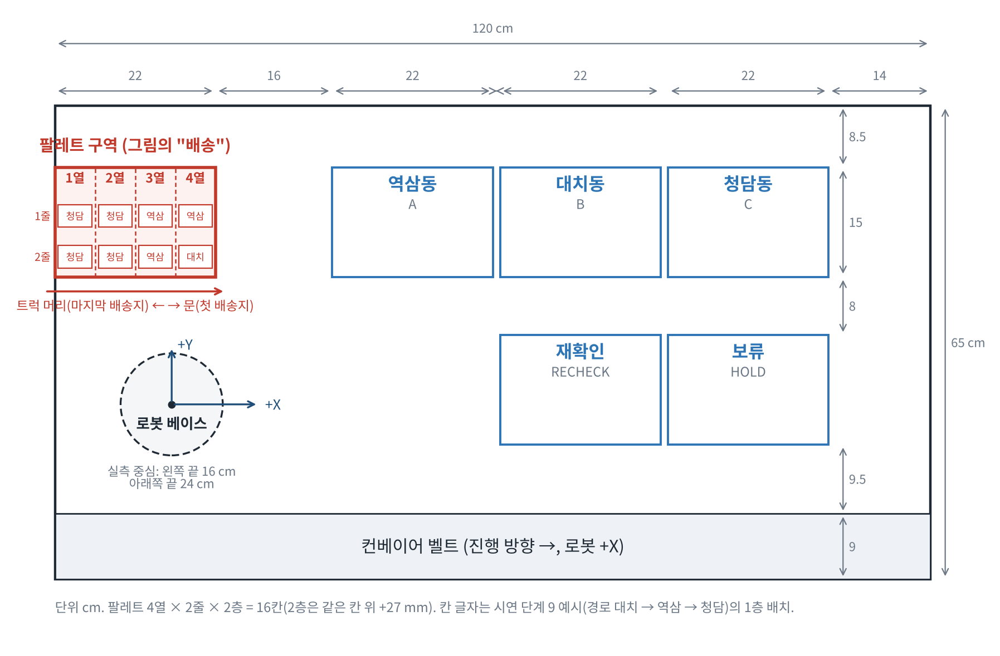
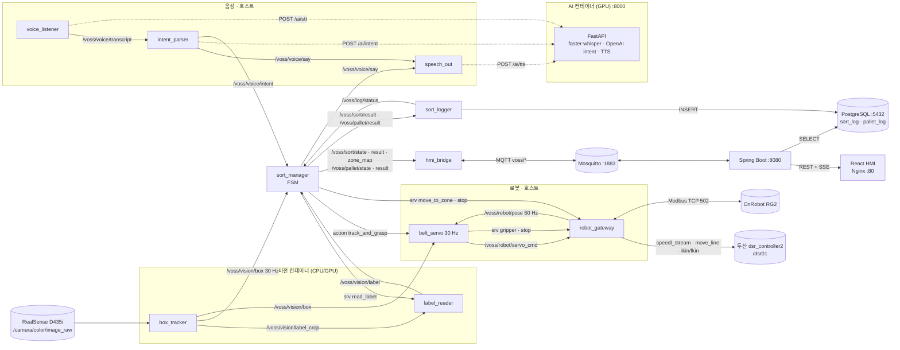

# VOSS — 말로 지시하는 물류 분류 어시스턴트 (Voice-Operated Sorting System)

벨트를 멈추지 않고, 손목 카메라 한 대로 움직이는 택배 박스를 따라가 집고, 송장을 세 번 읽고, 그래도 모르면 사람에게 묻는다. 배송 순서를 말하면 트럭 짐칸 순서로 팔레트에 싣는다.

[](docs/requirements/sprint2/workbench_v1.5.png)

> 두산로보틱스 ROKEY BOOT CAMP 9기 · 협동-2 프로젝트 "AI 기반 협동 로봇 작업 어시스턴트 구현" · TEAM C-3조 **VOSS** (남현지 PL · 정의석 · 박병후 · 김학민) · 2026-10-05 ~ 10-16 (시연 10/15, 발표 10/16)

## 시연 영상

시연 녹화(ROS bag `~/voss_data/1015/demo2`, 17.6분)와 기록표는 레포 밖 팀 Drive `1015/` 에 있다(CLAUDE.md 규칙 8 — 촬영 데이터는 커밋하지 않는다). 영상 파일을 올리면 아래 자리에 링크한다.

| 분류 스토리 | 팔레타이징 스토리 |
|---|---|
| [영상 자리] "헬로, 로키. 작업 시작" → 우선 분류 → 전체 분류 → 재확인·질문·보류 | [영상 자리] "청담, 역삼, 대치 순서로 실어줘" → 되읽기 TTS → 16칸 적재 → 완료 안내 |

시연 절차와 각 단계의 발화·기대 동작은 [시연 대본](docs/demo-script.md), 결과 수치는 [measurements-1015](docs/measurements-1015.md)에 있다.

## 주요 기능

- **멈추지 않는 벨트 위에서 집는다**: 두산 M0609 손목의 D435i **RGB 만** 쓰고(깊이 미사용), 알려진 박스 높이 27 mm + 핸드아이 캘리브레이션으로 박스 윗면 중심을 베이스 좌표로 구한다. `belt_servo` 가 30 Hz 로 **v = v_belt(피드포워드) + Kp·e(위치 오차)** 속도 명령을 내고 `robot_gateway` 가 두산 `speedl_stream` 으로 흘린다. 6단계 FSM(PREPARE → TRACK → DESCEND → GRASP → LIFT → VERIFY)으로 한 박스를 약 11 s 안에 집는다.
- **송장은 세 번 읽는다**: ① 입구 관측에서 1차 OCR(집을지 결정) → ② 추종 중 선명 프레임 다수결로 2차 확정(같은 동 2장 + 반대표 없음) → ③ 재확인 구역에 내려놓고 정지 상태에서 3차 재판독. 분류코드(`S07-01~03`)와 동 이름을 **자모 편집거리** 퍼지 매칭으로 교차 검증한다. PaddleOCR 한국어 로컬 엔진.
- **판독 실패를 설계에 넣었다**: 그래도 모르면 "NNN번 박스 송장을 확인하지 못했습니다. 역삼동, 청담동 중 어디입니까?" 하고 묻고, 30 s 무응답이면 보류 구역에 둔다. 시연 중 정지 0회.
- **사람은 말로만 개입**: "헬로, 로키" 호출어 뒤 명령만 받는다(에너지 VAD → faster-whisper → 호출어 문자열 매칭 → LangChain + OpenAI intent JSON → 허용 목록 검증 → FSM). 정지 키워드("멈춰·정지·스톱·그만")는 호출어 없이 통과한다. **LLM 은 로봇을 직접 움직이지 않는다** — intent JSON 만 만들고, 실행은 `sort_manager` 상태기계가 한다. 음성이 안 되면 같은 명령을 웹 HMI 버튼·텍스트로.
- **분류에서 적재까지(팔레타이징)**: 배송지 순서를 말하면 팔레트(4열 × 2줄 × 2층 = 16칸)를 **트럭 짐칸**으로 보고 첫 배송지가 문(4열) 쪽에 오도록 마지막 배송지부터 싣는다. 16개를 넘으면 물량 많은 동부터 싣고 초과분은 원래 구역에 두고 음성·HMI 로 알린다. 배치 계획은 ROS 없이 시험하는 순수 함수다.
- **웹 HMI + 이력**: 운전·분류·답변·구역 초기화·팔레타이징 버튼, 구역별 집계, 보류 목록, OCR 최근 결과, 로봇 상태, 손목·USB 카메라 화면, 2D 작업공간 애니메이션, 3D 팔레트 배치도·진행률·초과 경고, CSV 내보내기. 브라우저와 Spring Boot 는 ROS 에 붙지 않고 **MQTT 로만** 연결된다. 박스마다 OCR 원문·판정·구역·칸·결과·시각을 PostgreSQL `sort_log`·`pallet_log` 에 남긴다.
- **드라이버 제약은 구조로 흡수**: 두산 서비스는 `robot_gateway` 의 **단일 직렬 호출 큐**만 부른다(동시 호출 시 드라이버 정지). servo 명령은 200 ms watchdog, TCP z 하한·x 범위·yaw 한계를 감속 거리까지 넣어 자르고, 끊기면 0 속도 + `move_stop`. 컨트롤러 등록 TCP 가 설정과 다르면 MoveToZone 을 거부한다.
- **계약 우선**: 토픽·서비스·메시지·YAML·MQTT·REST 계약을 `docs/interfaces/` 에 먼저 적고 코드를 바꾼다. `voss_msgs` 나 `voss_config.yaml` 만 바뀐 PR 은 CI 가 실패한다. 설정은 `config/voss_config.yaml` 하나, 읽는 노드는 `sort_manager` 하나. 결정은 ADR 16건.

## 시스템 구성

### 아키텍처 한눈에

공용 PC 한 대(Nodes PC) 위의 ROS 2 호스트 프로세스 + 컨테이너 5종, 로봇 전용 유선망. **느린 판단(OCR·LLM, 수백 ms)과 30 Hz 제어 루프를 프로세스로 분리**하고 `sort_manager` 가 조율한다. 비전·음성은 판단 결과만 올리고, 로봇·스피커·HMI 는 `sort_manager` 의 명령만 받는다.



| 위치 | 구성 | 역할 |
|---|---|---|
| 호스트 (공용 PC, ROS 2 Jazzy) | 두산 브링업(`m0609_rg2_bringup`), `robot_gateway`, `belt_servo`, `sort_manager`, `voice_listener` · `intent_parser` · `speech_out`, `hmi_bridge`, `sort_logger`, `realsense2_camera`, `camera_preview`(:8091) · `usb_camera_preview`(:8092) | 서보 루프·FSM·음성·DB 기록. 두산 드라이버를 부르는 노드는 `robot_gateway` 하나 |
| 비전 컨테이너 (`ros:jazzy-ros-base-noble`, `--network host`) | `box_tracker`(OpenCV 분할 검출, GPU 불필요), `label_reader`(PaddleOCR 3.7, CPU 또는 `compose.gpu.yml` 로 GPU) | 박스 검출·추적·좌표 변환, 송장 크롭·OCR·퍼지 매칭 |
| AI 컨테이너 (CUDA 12.6, GPU) | FastAPI `/ai/stt` · `/ai/intent` · `/ai/tts` (faster-whisper small, LangChain + OpenAI `gpt-4o`, `gpt-4o-mini-tts`) | 음성 ROS 노드가 `127.0.0.1:8000` 으로 호출 |
| DB 컨테이너 | PostgreSQL 16 (`sort_log` · `pallet_log` · `session_plan`), writer `voss_logger` / reader `voss_web` | 호스트 볼륨 `/var/lib/voss/pgdata` |
| MQTT 컨테이너 | Mosquitto 2, `127.0.0.1:1883`, 익명 금지, 계정별 ACL(`web` · `bridge` · `debug` · `voice_preview` · `voice_web`) | ROS ↔ 웹 유일 경계 |
| 웹 컨테이너 | Spring Boot 3.5 (Java 21, `127.0.0.1:8080`) + React 19/Vite 빌드를 Nginx(:80)가 서빙·프록시 | REST · SSE · MQTT 클라이언트 · DB 조회. 원격 브라우저는 STOP 만 허용 |
| 로봇 셀 | 두산 M0609 + 컨트롤러 + OnRobot RG2 + D435i(손목) + 탁상 컨베이어(아두이노) | 로봇 컨트롤러 유선 전용 서브넷, 카메라 USB 3.0, OpenAI API 는 별도 NIC |

컨테이너는 모두 `network_mode: host`, 호스트와 같은 `ROS_DOMAIN_ID`(운용 30)·`rmw_cyclonedds_cpp`. `docker compose up` 과 로봇을 움직이는 명령은 사람이 비상정지 옆에서 실행한다(`.claude/settings.json` 에서 Claude 는 deny).

### ROS 2 패키지와 노드

| 패키지 | 노드 | 발행 | 구독 · 호출 | 제공 서비스 · 액션 |
|---|---|---|---|---|
| `voss_msgs` | — | msg 12 · srv 7 · action 1 (아래 "메시지") | | |
| `voss_robot` | `robot_gateway` | `/voss/robot/pose` (PoseStamped, TCP=핑거 끝, 50 Hz) · `/voss/robot/state` (RobotState, 2 Hz + 변화 시, transient_local) · `/dsr01/dsr_controller2/speedl_stream` | `/voss/robot/servo_cmd` (TwistStamped) · `/dsr01/joint_states` · `/dsr01/error` · `/dsr01/robot_disconnection` · 두산 서비스 `get_current_tool_flange_posx` `get_current_posx` `get_robot_state` `ikin` `fkin` `move_line` `move_spline_task` `check_motion` `move_stop` · RG2 Modbus TCP | `/voss/robot/stop` (Trigger, 멱등) · `/voss/robot/gripper` (Gripper) · `/voss/robot/move_to_zone` (MoveToZone: PLACE/DROP/VIEW/PICK × A/B/C/RECHECK/HOLD/PALLET/OBSERVE) |
| `voss_servo` | `belt_servo` (+ sim 전용 `fake_box` `fake_gripper` `sim_check` `gate_summary` `z_compare` `emu_rot`) | `/voss/robot/servo_cmd` (30 Hz, TCP 선속도 m/s · `angular.z` rad/s, `base_link`) | `/voss/vision/box` · `/voss/robot/pose` · 서비스 `/voss/robot/gripper` `/voss/robot/stop` | 액션 `/voss/servo/track_and_grasp` (TrackAndGrasp — 파라미터가 READY 일 때만 서버 생성) |
| `voss_vision` | `box_tracker` | `/voss/vision/box` (BoxTrack, 트랙당 1건 ~30 Hz, best_effort) · `/voss/vision/label_crop` (LabelCrop, 트랙당 ≤ 5 Hz) | `/camera/color/image_raw` · `camera_info` · `/voss/robot/pose` · `/voss/sort/state` (크롭 stage 결정) | |
| | `label_reader` | `/voss/vision/label` (LabelRead, stage 1·2) — **OCR 예열 + zone_map 수신 뒤** 생성 | `/voss/vision/label_crop` · `/voss/sort/zone_map` (후보 유일 출처) · `/camera/color/image_raw` (read_label 요청 중만) | `/voss/vision/read_label` (ReadLabel, stage 3 전체화면 재판독) |
| | `camera_preview` / `usb_camera_preview` | HTTP `127.0.0.1:8091/frame.jpg` (손목 카메라 + 검출 오버레이) / `:8092/frame.jpg` (Logitech C270) | `/camera/color/image_raw` · `/voss/vision/box` | |
| `voss_manager` | `sort_manager` | `/voss/sort/state` (SortState, 2.5 Hz + 변화) · `/voss/sort/result` (SortResult) · `/voss/sort/zone_map` (ZoneMap, transient_local) · `/voss/pallet/state` (PalletState, transient_local) · `/voss/pallet/result` (PalletResult) · `/voss/voice/say` | `/voss/vision/box` · `/voss/vision/label` · `/voss/voice/intent` · `/voss/robot/pose` · `/voss/robot/state` · `/voss/log/status` · 액션 `track_and_grasp` · 서비스 `move_to_zone` `stop` `read_label` `list_placements` | `/voss/sort/command` (Command: start/stop/resume/priority/answer/reset_zone/palletize/recheck) |
| `voss_voice` | `voice_listener` | `/voss/voice/transcript` · `/voss/voice/status` (JSON phase: WAKE_DETECTED/COMMAND_ACCEPTED/RECOGNITION_FAILED/TIMED_OUT) · `/voss/voice/say` | 마이크(sounddevice 16 kHz) · `/voss/sort/state` · HTTP `POST /ai/stt` | |
| | `intent_parser` | `/voss/voice/intent` (Intent) · `/voss/voice/say` · `/voss/voice/text/reply` | `/voss/voice/transcript` · `/voss/voice/text` (웹 텍스트) · `/voss/sort/zone_map` · `/voss/sort/state` · HTTP `POST /ai/intent`, `GET /api/stats` (이력 질의), `POST /api/commands` (`command_transport=web_api`) | |
| | `speech_out` | 스피커 (`aplay` S16LE 24 kHz) | `/voss/voice/say` → 큐(20) → HTTP `POST /ai/tts` 스트리밍 | |
| `voss_hmi` | `hmi_bridge` | MQTT `voss/state` `result` `zone_map`(retained) `robot` `box_track` `robot_pose` `robot_joints` `voice_status` `log_status`(retained) `pallet/state`(retained) `voice/text/reply` `command/ack` · ROS `/voss/voice/say` `/voss/voice/text` | ROS `/voss/sort/*` `/voss/robot/state` `/voss/robot/pose` `/dsr01/joint_states` `/voss/vision/box` `/voss/voice/status` `/voss/log/status` `/voss/pallet/state` · MQTT `voss/command` `voss/voice/request` `voss/voice/text` → `/voss/sort/command` 호출 | |
| | `sort_logger` | `/voss/log/status` (STARTING/OK/DB_ERROR/SPOOL_FULL, 1 Hz) · PostgreSQL `sort_log` · `pallet_log` INSERT (실패 시 JSONL 스풀 → 1·2·5·10·30 s 재전송) | `/voss/sort/result` · `/voss/pallet/result` | `/voss/log/list_placements` (ListPlacements) |
| `voss_bringup` | (launch 만) | `voss_host.launch.py` (gateway → realsense → sort_logger → [vision] → belt_servo → sort_manager → 음성 3노드 → hmi_bridge) · `voss_vision.launch.py` · `voss_dry_run.launch.py` (녹화 재생 + 모의) | | |

QoS: `/voss/vision/box` · `/voss/robot/pose` · `/voss/robot/servo_cmd` 는 best_effort·depth 1(`box` 구독은 depth ≥ 동시 박스 수); `state` · `result` · `label` · `voice/*` 는 reliable·depth 10; `zone_map` · `robot/state` · `pallet/state` 는 reliable·transient_local·depth 1. 전체 표와 변경 이력은 [docs/interfaces/topics.md](docs/interfaces/topics.md).

### 메시지 (`src/voss_msgs`)

| 종류 | 이름 | 요지 |
|---|---|---|
| msg | `BoxTrack` | track_id, 픽셀 u·v·bbox, 촬영 stamp, `position_base`(박스 윗면 중심 m, `base_link`), `position_valid`, `position_source`(OBSERVE_HOMOGRAPHY / HAND_EYE), `calib_version`, `yaw_base`·`yaw_valid` |
| msg | `LabelCrop` / `LabelRead` | 크롭 이미지 + stage(1 입구 · 2 추종 · 3 재확인) + sharpness / code · dong · confidence · stage · raw_text · dong_alt · confidence_alt |
| msg | `Intent` | type(start · stop · resume · priority · answer · recheck · update_zone_map · palletize), dong, zone, raw_text, box_id, route[1~3] |
| msg | `SortState` | state(IDLE · RUNNING · PICKING · RECHECK · ASKING · PAUSED · PALLETIZING), box_id, pending_question, track_id, ready, not_ready[] (ROBOT/SERVO/VISION/OCR/LOG), session_id |
| msg | `SortResult` | box_id(`<session>-NNN`), code, dong, confidence, decided_by(OCR · RECHECK · OPERATOR · NONE), zone, outcome(PLACED · HELD · FAILED · PASSED), reason, attempts, slot, started_at, stamp, rule_version |
| msg | `ZoneMap` / `ZoneMapEntry` | 동 → 구역 · 분류코드 · 별칭 목록, version |
| msg | `RobotState` | connected(두산 + RG2), state(READY · BUSY · STOPPED · ERROR), action, gripper_width_mm, error_code(ESTOP · SAFETY_STOP · GRIPPER_ERROR · TIMEOUT), detail |
| msg | `PalletState` / `PalletResult` / `Placement` | 실행 run_id, route, 동별 load/overflow/excluded, 16칸 slot_state(EMPTY · PLANNED · MOVING · DONE · FAILED) / 박스별 pallet_slot·col·lane·layer, outcome(DONE · FAILED · OVERFLOW · EXCLUDED) / 세션 적재 기록 |
| srv | `Command` · `Gripper` · `MoveToZone` · `ReadLabel` · `ListPlacements` · `TeachZone`(정의만) · `UpdateZoneMap`(정의만) | 운전 명령 / 폭·힘 → 실제 폭·grip_detected / 구역·칸·모드 → ok·message·placed_stamp / 트랙·칸 → LabelRead stage 3 / 세션 → Placement[] |
| action | `TrackAndGrasp` | goal track_id → result grasped · reason(OK · GRASP_FAILED · LOST · OUT_OF_REACH · STALE_INPUT · DEVICE_ERROR · CANCELED) · attempts, feedback phase |

필드 전문은 [docs/interfaces/voss_msgs.md](docs/interfaces/voss_msgs.md).

### 데이터 흐름 — 박스 하나의 여정

1. **시작**: "헬로, 로키. 작업 시작" → `intent_parser` → `/voss/voice/intent` → `sort_manager` IDLE → RUNNING. "작업을 시작합니다." 발화, `MoveToZone(OBSERVE)` 로 관측 자세(벨트 상류 끝 위 약 15 cm) 이동.
2. **관측·1차 OCR**: `box_tracker` 가 1920×1080 30 fps 프레임에서 HSV 로 흰 송장을 분할해 박스를 검출·추적(등속 예측 탐욕 매칭, `min_hits` 5), 촬영 시각의 TCP pose 를 보간(`pose_lag_ms` 15)해 핸드아이로 픽셀 → 베이스 좌표를 낸다. 관측 자세에서는 벨트 평면 호모그래피(`plane_z_mm` 100.8)로도 검산한다. 송장 크롭을 `label_reader` 로 보내 PaddleOCR 로 읽고 zone_map 과 퍼지 매칭 → `/voss/vision/label` stage 1.
3. **판단**: `sort_manager` 가 코드·동 교차 검증(일치 → 확정, 불일치 → 코드 우선·신뢰도 하향, conf < 0.6 → LOW_CONF). 지시 대상(priority)이 아니면 집지 않고 흘려보낸다(PASSED). 목적 구역 칸(`slot_at`, 3×2×2층)을 잡고 `TrackAndGrasp` goal → PICKING.
4. **추종·파지**: `belt_servo` 가 30 Hz 로 PREPARE(사전 개방 90 mm) → TRACK(FF+P, 벨트 상류로는 안 감) → DESCEND(TCP z = 윗면 −19 mm, 사다리꼴 프로파일, 사각 구간은 FF 만) → GRASP(39 mm · 14 N) → LIFT(grip_detected + 폭 39.5~44 mm) → VERIFY(재닫힘). 추종 중 선명 프레임을 stage 2 로 보내 **2차 OCR** 다수결로 판독을 확정·보강(거꾸로 올린 박스는 180° 먼저).
5. **적재**: `MoveToZone(zone, slot, PLACE)` — 컨트롤러 등록 TCP 확인 → ikin 도달성 → 수직 상승·수평·수직 하강(300 mm/s · 900 mm/s² · 블렌딩 30 mm, 베이스 뒤를 지나면 원호 경유 스플라인) → 개방(50 mm) → OBSERVE 복귀. `SortResult(PLACED)` → `sort_logger` → `sort_log` 1행, `hmi_bridge` → MQTT → SSE → HMI ≤ 1 s.
6. **예외**: 불확실하면 재확인 칸에 PLACE → `MoveToZone(RECHECK, VIEW)` → `read_label(slot)` **3차** → 확정이면 `PICK` 후 목적 구역 / 그래도 모르면 ASKING: 후보 2개 + 보류를 음성·HMI 로 질문, 답(`answer <box_id>|<동|HOLD>`)대로 적재, 30 s 무응답 → HOLD.
7. **팔레타이징**: "청담, 역삼, 대치 순서로 실어줘" → `palletize` → `ListPlacements(session)` 로 적재 기록 조회 → `pallet_plan` 순수 함수로 16칸 배치(열 단위, 마지막 배송지부터 1열, 초과분 OVERFLOW) → 되읽기 TTS → 박스마다 `PICK`(구역 칸, 최대 3회) → `DROP`(팔레트 칸) → `PalletState`/`PalletResult` → `pallet_log` → 완료 안내 → 빈 구역 카운터 0.

### sort_manager 상태기계

```
IDLE ──start──▶ RUNNING ──LabelSeen──▶ PICKING ──GoalDone·PLACE──▶ RUNNING
                  │                      │ 불확실                  
                  │                      ▼                         
                  │                   RECHECK ──확정──▶ PICK → PLACE ──▶ RUNNING
                  │                      │ 미확정                   
                  │                      ▼                         
                  │                    ASKING ──answer / 30 s──▶ 목적 구역 / HOLD
                  │
  (모든 상태) ──stop──▶ PAUSED ──resume──▶ resume_to(RECHECK · ASKING · PICK · PLACE) 또는 OBSERVE
  RUNNING/PAUSED ──palletize──▶ PALLETIZING ──완료──▶ 시작 전 상태
```

- `step(ctx, event)` 순수 함수(`sort_fsm.py`) — 전이·타임아웃을 ROS 없이 단위 시험한다. 준비 판정(`readiness.py`): ROBOT(RobotState ≤ 1.5 s · connected · READY/STOPPED) · SERVO(액션 서버 존재) · VISION(`/voss/vision/box` 발행자) · OCR(`/voss/vision/label` 발행자) · LOG(`/voss/log/status` ≤ 3 s · STARTING 아님). 하나라도 빠지면 start/resume 거부.
- stop 은 `/voss/robot/stop` 을 **최우선**으로 부른 뒤 goal 취소 → PAUSED. stop 응답 실패(3 s)면 `stop_failed` → ROBOT 미준비, 재성공 전 resume 거부. 구역이 가득 차면(A/B/C 12칸, RECHECK·HOLD 2칸) PAUSED(full_zone) → `reset_zone` 뒤 재개.
- 팔레타이징(`pallet_fsm.py`): 실행 중 start/priority/answer 거부, GRIP_FAIL 3회 → 1층 박스면 다음, 2층이면 PAUSED + 안내, 재개 시 RG2 폭(39.5~44 mm)으로 쥐고 있는지 판단(쥐고 있으면 DROP, 놓쳤으면 DROPPED).

### 안전 장치

| 어디 | 무엇 | 수치 |
|---|---|---|
| `robot_gateway` servo guard | stamp 가 stop 이전·0.2 s 보다 오래됨·MoveToZone 중·pose 0.1 s 초과면 거부; 선속도 100 mm/s 초과 비례 축소; 예측 위치(지연 60/20 ms) + 감속 거리 v²/2a 로 **TCP z ≤ 78 mm, x ∉ [−107, 638] mm** 면 그 성분 0; 각속도 기본 0(켜면 ≤ 60 °/s, 관측 yaw ± 100~130°) | watchdog 200 ms 만료·stop·종료 시 **0 속도 + 항상 `move_stop`(QSTOP)** |
| `robot_gateway` MoveToZone | 컨트롤러 등록 TCP 가 `tcp_offset_mm` ±3 mm 또는 없음(플랜지)이 아니면 **NOT_CONFIGURED 거부**(10/08 246 mm 하강 사고 재발 방지); 경로 이탈 > 15 mm(스플라인 +25) → `move_stop` + LIMIT; 이동 높이 TCP ≥ 120 mm(트레이 안 ≥ 60, C 40), J3 ≥ 15°; 두산 호출 0.5 s 타임아웃 3회 연속 → FAULT | PICK 은 이미 쥐고 있으면 거부(자동 개방 금지) |
| `belt_servo` | 자체 clamp 0.08 m/s · 0.1 m/s², x 여유(벨트속도 × (하강 + 닫힘 2.5 s) + 10 mm) 없으면 OUT_OF_REACH, 하강 사각 체류 상한, 입력 STALE 0.3 s · LOST 0.5 s, cancel → stop 호출, 모든 종료 경로 마지막 명령 0 | GRASP 실패 시 안전 후퇴 |
| `sort_manager` | 준비 5항목 검사, stop 코얼레싱(진행 중 stop 공유), 장비 응답 토큰으로 늦은 응답 무시, 구역 가득 → PAUSED | goal 5/120 s · move 60 s · read 15 s |
| 음성 | 정지 키워드는 호출어 없이 통과, LLM 응답은 허용 목록(동·구역·경로 1~3 중복 없음)으로 재검증, 세션 중복 억제 | — |
| 운영 | 로봇·벨트·그리퍼를 움직이는 명령은 사람이 비상정지 옆에서; `dry_run`·재생 모드는 운용 도메인 30 에서 기동 거부; 원격 브라우저는 STOP 만 | — |

### MQTT · 웹 · AI · DB

**MQTT (`docker/mqtt`, [docs/interfaces/mqtt.md](docs/interfaces/mqtt.md))** — ROS → 웹: `voss/state` `voss/result` `voss/zone_map`(retained) `voss/robot` `voss/box_track` `voss/robot_pose` `voss/robot_joints` `voss/voice_status` `voss/log_status`(retained) `voss/pallet/state`(retained) `voss/command/ack` `voss/voice/text/reply`. 웹 → ROS: `voss/command` `{command_id, type, args, raw_text, sent_at}` · `voss/voice/request`(버튼 안내 문구 → TTS) · `voss/voice/text`(자연어 텍스트). 계정별 read/write ACL, 익명 금지.

**Spring Boot `/api` ([docs/interfaces/web_api.md](docs/interfaces/web_api.md))** — `POST /api/commands`(stop 외는 로컬 127.0.0.1 만) · `GET /api/stream`(SSE: state · result · zone_map · robot · command_ack · log_status · pallet_state · voice_status · box_track · robot_pose · robot_joints · text_reply · link) · `GET /api/sessions/current` · `PUT /api/sessions/current/plan`(투입 예정 수량) · `GET /api/stats?query_kind=count_by_dong|held_count|remaining_count` · `GET /api/results` · `GET /api/export.csv` · `GET /api/pallet/placements/latest` · `POST /api/voice/text` · `POST /api/voice/announce`. Nginx 가 `/api/` → 8080, `/camera/gripper/` → 8091, `/camera/usb/` → 8092 를 프록시한다.

**React HMI (`docker/web/frontend`)** — `App.tsx`(SSE 구독, 운전·분류·답변·구역 초기화 패널, 집계 Metric, 이력·OCR 결과), `VossSortingWorkspace`(로봇 베이스 기준 2D 작업공간: 트레이·팔레트·컨베이어, `robot_pose` 로 팔 애니메이션, `box_track` 박스, 음성 표시등 초록/노랑/빨강), `PalletPanel`(배송지 1~3 선택, 3D SVG 팔레트 16칸, 진행률, 초과 경고, 비움 확인), `GripperCameraPanel` · `UsbCameraPanel`(JPEG 폴링), `TextCommandPanel`(웹 텍스트 명령 → `text_reply`).

**AI (`docker/ai`)** — `POST /ai/stt`(WAV → faster-whisper, `initial_prompt` "헬로우 로키 …", 프롬프트 메아리 필터) · `POST /ai/intent`(`{text, allowed:{dongs, aliases, zones}}` → JSON schema strict: type · dong · zone · query_kind · route · raw_text, `temperature 0`, 3 s 타임아웃) · `POST /ai/tts`(S16LE 24 kHz PCM 스트리밍, voice `coral`).

**DB (`docker/db/init/01_schema.sql`, `migrations/20261012_sprint2_pallet.sql`)** — `sort_log`(PK box_id; session_id · track_id · code · dong · confidence · decided_by · zone · result · reason · raw_text · second_region · rule_version · attempts · retries(생성 컬럼) · started_at · finished_at · inserted_at · slot), `pallet_log`(PK run_id + box_id; route_index · zone · slot · pallet_slot 0~15 · pallet_col 1~4 · pallet_lane 1~2 · pallet_layer 1~2 · result DONE/FAILED/OVERFLOW/EXCLUDED · reason · attempts · finished_at), `session_plan`(session_id · planned). 마이그레이션은 구조를 검증한 뒤 롤백 또는 COMMIT.

### 설정과 캘리브레이션 (`config/`)

- `voss_config.yaml` — 유일한 설정 원본(`sort_manager` 만 읽고 나머지는 `/voss/sort/zone_map` 구독). zone_map(역삼동 → A `S07-01` · 대치동 → B `S07-02` · 청담동 → C `S07-03`, 별칭), 구역 플랜지 좌표·격자(A/B/C 3×2 pitch 60 × 2층, recheck·hold 2×1, pallet 4×2 pitch 50/60 × 2층), `observe_pose`, `robot.tcp_offset_mm [1.382, 2.684, 246.642]`, `belt.speed_cmps 4.56` · `direction_base`, `gripper {pre_open 90, place_open 50, pick_open 50, grasp_width 39, force_n 14}`, `ocr.confidence_min 0.6`. 스키마: [docs/interfaces/voss_config.md](docs/interfaces/voss_config.md).
- `hand_eye.yaml` — PARK 핸드아이 + 터치 보정(`T_tcp_camera`, K 1358/1357 px, 재투영 max 1.27 px, 검증 max 4.56 mm, `pose_lag_ms_measured 60`, `moving_verified: true`). `belt_homography.yaml` — 관측 자세 벨트 평면 호모그래피(`plane_z_mm` 100.8, 검증 max 2.63 mm). 스키마: [docs/interfaces/calibration.md](docs/interfaces/calibration.md). 생성 도구는 `tools/calib/`.
- `belt_servo` 실기 파라미터 `belt_servo_real.yaml` 은 레포 밖 `~/voss_ws/config/`(gitignore). 예시 `src/voss_servo/config/belt_servo_real.yaml.example`, sim 값 `belt_servo_sim.yaml`.

### 추가 도면·문서

노드별 계약 [docs/interfaces/](docs/interfaces/) · 아키텍처 요약 [docs/architecture.md](docs/architecture.md) · 결정 기록 [docs/adr/](docs/adr/) (0001 인터페이스 명명 · 0002 파지 게이트 · 0003 벨트 호모그래피 · 0004/0011 박스 검출 · 0005 RG2 Modbus 직접 · 0006 웹·AI·DB 스택 · 0007 호출어 · 0008 OCR·퍼지 매칭 · 0009 31 mm 파지 · 0010 두산 servo 경로 · 0012 수치 목표 · 0013 TTS · 0014 Sprint 2 게이트 · 0015 레포 이전 · 0016 Web PC 음성 경로) · 요구사항 BRD v1.7 / SRD v1.0 [docs/requirements/](docs/requirements/) · 설계 노트 [src/voss_servo/design/](src/voss_servo/design/).

## 개발 환경

| 항목 | 값 |
|---|---|
| 호스트 | Ubuntu 24.04 LTS · ROS 2 Jazzy · `rmw_cyclonedds_cpp` · `ROS_DOMAIN_ID=30`(운용) · Python 3.12 · 워크스페이스 `~/voss_ws/src/rokey_cobot2_VOSS` |
| 로봇 드라이버 | `doosan-robot2` (`dsr_controller2`, `/dsr01`) + `m0609_rg2_bringup` (레포 밖 `~/ws_cobot_pjt`), RG2 는 pymodbus 로 Compute Box 직접(192.168.1.1:502) |
| 비전 | OpenCV(분할 검출·핸드아이·호모그래피) · PaddleOCR 3.7.0 / paddlepaddle 3.3.1 (korean, CPU 또는 cu126 GPU) · rosbag2 mcap 재생 |
| 음성·AI | faster-whisper 1.1 (small, CUDA fp16) · LangChain + OpenAI `gpt-4o` (structured output) · OpenAI `gpt-4o-mini-tts` · sounddevice · ALSA `aplay` |
| 컨테이너 | Docker Compose 5종 — `docker/{vision,ai,db,mqtt,web}` (`network_mode: host`), CUDA 12.6 runtime(ai), `nvidia` 장치 예약 |
| 웹·DB | Spring Boot 3.5 (Java 21, Gradle, spring-integration-mqtt, Paho) · React 19 + Vite 6 + TypeScript 5.7 · Nginx 1.27 · PostgreSQL 16 · Mosquitto 2 |
| 언어 · 도구 | Python 3.12 (ROS 노드 · FastAPI · 도구), Java (Spring Boot), TypeScript (React), Arduino C++ (컨베이어), colcon · pytest · ruff · Gradle · npm |
| CI | `.github/workflows/ci.yml` — `ros:jazzy-ros-base` 컨테이너에서 ruff → colcon build → colcon test → `voss_msgs`/`voss_config.yaml` 변경 시 `docs/interfaces/` 변경 강제. `@claude` 멘션 리뷰(`claude.yml`) |

세 단계로 검증한다: 로봇 없이 `dry_run` + 녹화 재생(`voss_dry_run.launch.py`, 개인 PC) → 두산 에뮬레이터(`rg2_dry_run`, `/dsr01/virtual_node`) → 실기(공용 PC). 개인 PC 4대와 공용 PC 가 같은 구성이라 4명이 로봇 한 대를 기다리지 않는다.

## 사용 장비

| 장비 | 모델명 · 사양 | 수량 | 용도 |
|---|---|---|---|
| 협동로봇 | 두산 M0609 (6축 · 가반 6 kg · 도달 900 mm) | 1 | 추종·파지·적재. `speedl_stream` TCP 속도 스트리밍 + `move_line`/`move_spline_task` |
| 로봇 컨트롤러 | 두산 컨트롤러, 유선 전용 서브넷 (`VOSS_ROBOT_HOST`:12345) | 1 | `dsr_controller2` 연결. 툴·TCP 등록은 펜던트 |
| 그리퍼 | OnRobot RG2 (스트로크 0~110 mm · 힘 3~40 N), Compute Box Modbus TCP | 1 | 31 mm 폭 파지: 개방 90/50 mm · 닫힘 39 mm · 14 N(종이 박스 보호), grip_detected·폭 피드백 |
| 손목 카메라 | Intel RealSense D435i (Eye-in-Hand, RGB 1920×1080 30 fps, 노출 고정 6 ms · WB 4600, **깊이 미사용**) | 1 | 박스 검출·추적·송장 OCR. USB 3.0 |
| 관제 카메라 | Logitech C270 USB 웹캠 | 1 | HMI 작업대 화면(`usb_camera_preview` :8092) |
| 컨베이어 | 탁상 미니 컨베이어, 벨트 1,040 × 70 mm, 스텝모터 + Arduino Uno(`tools/arduino/conveyor_test/conveyor_test.ino`), 약 4.56~4.9 cm/s | 1 | 박스 이송(멈추지 않음) |
| 부재 | 미니어처 택배 박스 46 × 31 × 27 mm × 20 + 자체 제작 송장 40 × 25 mm(분류코드 `S07-NN` 5.5 mm · 동 이름 4.5 mm · 받는 사람 2.8 mm, 흐린 1 · 판별 불가 1) | 20 | 분류·팔레타이징 대상 |
| 작업대 | 120 × 65 cm. 구역 트레이 A·B·C(3×2 칸 × 2층) · 재확인 · 보류(2×1) · 팔레트(4열 × 2줄 × 2층, X 피치 50 · Y 60 · 층 27 mm) | 1 | 위 그림 참고 |
| 공용 PC (Nodes PC) | Ubuntu 24.04 노트북(GPU), 로봇과 유선 | 1 | ROS 2 노드 · 컨테이너 5종 |
| Web PC (선택) | Ubuntu 24.04, SSH 포트 포워딩(8000·8080·1883·5432 / 8091·8092) | 1 | 브라우저 · 마이크/스피커 음성 노드(`scripts/web_pc_voice.sh`, `command_transport=web_api`) |

좌표·치수 실측값은 [docs/measurements-1006.md](docs/measurements-1006.md) 이후 날짜별 문서에, 구역 좌표는 `config/voss_config.yaml` 에만 둔다.

## 설치 및 실행

### 빠른 시작

```bash
# 1. 레포 (두산·RG2 브링업 ws 는 레포 밖: docs/setup/dev-environment.md)
mkdir -p ~/voss_ws/src && cd ~/voss_ws
git clone https://github.com/lambdaramji/rokey_cobot2_VOSS.git src/rokey_cobot2_VOSS

# 2. ROS 2 빌드·시험
source /opt/ros/jazzy/setup.bash
export RMW_IMPLEMENTATION=rmw_cyclonedds_cpp ROS_DOMAIN_ID=30
rosdep install --from-paths src --ignore-src -y
colcon build --symlink-install && source install/setup.bash
colcon test && colcon test-result --verbose
ruff check src/rokey_cobot2_VOSS && ruff format --check src/rokey_cobot2_VOSS

# 3. 컨테이너 (각 폴더의 .env.example → .env 를 채운 뒤, 사람이 실행)
cd src/rokey_cobot2_VOSS/docker
(cd mqtt && docker compose up -d)         # Mosquitto :1883 — 계정은 mqtt/README.md
(cd db && docker compose up -d)           # PostgreSQL :5432 + 마이그레이션 db/migrations/
(cd ai && docker compose up -d --build)   # FastAPI :8000 (GPU, OPENAI_API_KEY)
(cd web && docker compose up -d --build)  # Spring Boot :8080 + Nginx :80
(cd vision && docker compose -f compose.yml [-f compose.gpu.yml] up --build)  # box_tracker · label_reader

# 4. 로봇 없이 (녹화 재생 + 모의, 운용 도메인 30 에서는 거부)
ROS_DOMAIN_ID=77 scripts/voss_up.sh --dry --playback <bag 경로> --servo mock

# 5. 실기 — 사람이 비상정지 옆에서. T1 두산 브링업 → T2 gateway → T3 카메라 → T4 logger → T5 비전 → T7 belt_servo → T8 sort_manager → 음성 3노드 → hmi_bridge
export VOSS_ROBOT_HOST=<컨트롤러 IP>; source ~/voss_g0_env.sh    # 비밀값: deploy/node/.env.example
scripts/voss_up.sh --real --print        # 계획만 출력
scripts/voss_up.sh --real                # 단계별 준비 로그를 기다리며 기동, IDLE 에서 멈춤
scripts/voss_down.sh                     # 역순 종료 (RUNNING 중이면 거부)
```

주요 의존성: ROS 노드 `rclpy` · `paho-mqtt` · `psycopg2` · `pymodbus` · `numpy` · `opencv` · `sounddevice` · `PyYAML`(HTTP 는 표준 `urllib`), 비전 컨테이너 `paddleocr` · `paddlepaddle`, AI `fastapi` · `uvicorn` · `faster-whisper` · `langchain-openai` · `openai`(`docker/ai/requirements.txt`), 웹 `spring-boot-starter-web` · `spring-integration-mqtt` · `postgresql`(`build.gradle`), 프론트 `react` · `vite`(`frontend/package.json`).

실기 전 체크: `ros2 topic echo /voss/robot/state --once` 가 `connected: true` · `state: READY`, `/voss/log/status` 가 `OK`, `/voss/sort/state` 가 `ready: true`. 브라우저 `http://127.0.0.1` 에서 **시작** 또는 "헬로, 로키. 작업 시작". 시연 절차는 [시연 대본](docs/demo-script.md), 단계별 런북은 [docs/g0-runbook.md](docs/g0-runbook.md), 두 PC 배치는 [docs/interfaces/deployment_two_pc_trial.md](docs/interfaces/deployment_two_pc_trial.md).

### 웹 명령

```
start      새 세션 시작 (관측 자세 이동)
stop       현재 작업 중지 → PAUSED (소프트웨어 정지, 비상정지 대체 아님)
resume     PAUSED 에서 이어서 (RECHECK · ASKING · PICK · PLACE 또는 OBSERVE)
priority   <동>부터 분류 — 다른 동은 집지 않고 흘려보냄
answer     ASKING 질문에 <box_id>|<동|HOLD>
reset_zone A | B | C | RECHECK | HOLD | PALLET 칸 카운터 0
palletize  <동>,<동>,<동> 순서로 팔레트 적재
```

## 프로젝트 구조

```
.
├── src/                          ROS 2 Jazzy 자체 패키지 (ament_python, voss_msgs 만 CMake)
│   ├── voss_msgs/                  msg 12 · srv 7 · action 1 (계약의 타입 전문)
│   ├── voss_manager/               sort_manager — sort_fsm(순수 상태기계) · pallet_fsm · pallet_plan · readiness
│   ├── voss_servo/                 belt_servo — fsm · control(FF+P · 사다리꼴) · grip · rotate(J6) · sim 도구, design/ 설계 노트
│   ├── voss_robot/                 robot_gateway — doosan(직렬 큐) · rg2(Modbus) · servo_guard · zone_motion · geometry
│   ├── voss_vision/                box_tracker · label_reader · camera_preview — box_detect · hand_eye · belt_plane · ocr_engine · label_match
│   ├── voss_voice/                 voice_listener · intent_parser · speech_out — listen_logic(VAD · 호출어) · intent_logic · tts_client
│   ├── voss_hmi/                   hmi_bridge(ROS ↔ MQTT) · sort_logger(DB · 스풀)
│   └── voss_bringup/               voss_host · voss_vision · voss_dry_run launch
├── docker/
│   ├── vision/                     ros:jazzy + PaddleOCR 컨테이너 (compose.yml / compose.gpu.yml)
│   ├── ai/                         FastAPI — /ai/stt · /ai/intent · /ai/tts (faster-whisper · OpenAI)
│   ├── db/                         PostgreSQL 16 — init/01_schema.sql · migrations/
│   ├── mqtt/                       Mosquitto 2 — mosquitto.conf · acl
│   └── web/                        Spring Boot 백엔드 + React 프론트 + Nginx
├── config/                       voss_config.yaml · hand_eye.yaml · belt_homography.yaml · mosquitto 예시
├── scripts/                      voss_up.py/.sh · voss_down.sh · web_pc_voice.sh · measure_1006~1012/ 실측 키트 · integration/ HMI 지연 시험
├── tools/                        calib/(핸드아이 · 호모그래피 · 지연 평가) · vision/(bag 평가 · 오버레이) · ocr/ · mock/g0_mock.py · arduino/ · colab/(YOLO 학습)
├── data/servo/attempts/          belt_servo 시도 로그 (게이트 증거, 추적)
├── deploy/node/.env.example      Nodes PC 비밀값 템플릿
├── .github/                      CI · Claude 리뷰 · PR/이슈 템플릿 · CODEOWNERS
├── .claude/                      /sync · /pr · /standup 커맨드, 실행 deny 설정
└── docs/
    ├── architecture.md             노드 책임 · 배포 · 상태기계 요약
    ├── interfaces/                 토픽 · 메시지 · intent JSON · MQTT · voss_config · calibration · web_api · voice_status (코드보다 우선)
    ├── adr/                        설계 결정 0001~0016
    ├── requirements/               BRD v1.7 · SRD v1.0 · 개발일정 xlsx · Sprint 2 자료
    ├── measurements-1006~1015.md   날짜별 실측 (값은 여기에만)
    ├── plan.md · pending-decisions.md · conventions.md
    ├── g0-runbook.md · g1-gate.md · sprint2-gate.md · demo-script.md
    ├── setup/                      개발 환경 · Drive 구조
    ├── testing/ · verification/    음성-웹 연동 시험 · 팔레타이징 검증 보고
    └── requirements/sprint2/workbench_v1.5.png   작업대 구성도
```

레포 밖: `~/ws_cobot_pjt`(두산 · RG2 브링업), `~/voss_ws/config/belt_servo_real.yaml`(실기 파라미터), `~/voss_data/`(녹화 · 로그 · 기록표), 모델 가중치·녹음·촬영 데이터(`.gitignore`, 팀 Drive — [docs/setup/drive.md](docs/setup/drive.md)). 제공 드라이버는 수정하지 않는다.

## 결과

10/10 G1 게이트 · 10/13 Sprint 2 게이트 · **10/15 시연 2회차**(두산 M0609, 팀원 입회, ROS bag 대조) 값이다. 목표는 BRD 9장 · ADR-0012 전원 승인값.

| 항목 | 결과 | 목표 | 판정 |
|---|---|---|---|
| 이동 중 추종 파지 성공률 (G1 게이트 10/10) | **20 / 20**, 모두 1회 시도 | 14 / 20 (70 %) | 달성 |
| 송장 OCR 분류코드 정확도 | 정지 송장 **50 / 50**(흐린 5 포함) · 추종 중 판독 실기 31장 + 오프라인 105장 모두 정답 | ≥ 90 % (흐린 송장 제외 ≥ 95 %) | 달성 |
| 시연 완주 — 올바른 구역 | **20 / 20** (A 역삼 7 · B 대치 6 · C 청담 6 · HOLD 1) | 20개 중 16개 이상 | 달성 |
| 박스당 사이클 (감지 → 적재) | 바로 분류 최장 **18.4 s** (재확인·30 s 질문 대기 포함 최장 67.5 s) | ≤ 30 s | 달성 |
| 재확인 흐름 | 4건 모두 완주 (흐린 송장 → 작업자 답 → A / 판별 불가 → 30 s 무응답 → 보류 / 거꾸로 올린 박스 2건 → 재판독·질문 → A) | 정지 없이 재판독·질문·보류 | 달성 |
| 팔레타이징 (run `20261015T121315-0193`) | **16 DONE · 실패 0 · 초과 3**, 박스당 최대 15.3 s, 전체 **2분 56.6초**, 계획 칸 = 놓은 칸 16/16, 2층 밀림 0 | 박스당 ≤ 30 s, 경로대로 | 달성 |
| 검출 주기 / 카메라 → 발행 지연 | 29.8~30.0 Hz / p95 49 ms (검출 p95 약 4 ms) | 30 Hz / ≤ 100 ms | 달성 |
| belt_servo 30 Hz 틱 | 평균 33.3 ms · 최대 38.3 ms, 36.3 ms 초과 0.2 % | ≤ 40 ms | 달성 |
| 캘리브레이션 오차 | 호모그래피 검증 max 2.63 mm · 핸드아이 터치 검증 max 2.44 mm | ≤ 5 mm | 달성 |
| 추종 중 2차 OCR (10/15 저녁 고친 판) | 거꾸로 올린 박스 **5 / 5** 추종 중 확정(파지 시작 뒤 4.2~5.2 s), 장당 OCR 6.8 → 2.7 s, 사이클 약 37 → 19 s, 틀린 구역 0 | — | 달성 |
| 시연 중 비상정지·비정상 정지 | **0회** | 0회 | 달성 |
| 멈춤·재개 (시연 속도 300 mm/s) | 시연 2회차에서 미수행 — 10/14 450 mm/s 실기에서 stop 응답 4/5 TIMEOUT 미해결 | — | 미확인 |
| 음성 명령 (시연 당일) | 되읽기 TTS 는 나옴, 명령 입력은 HMI 버튼 사용 (`/voss/voice/intent` 0건) | 지시 해석 ≥ 95 % | 미실시 (별도 실기 평가 `src/voss_voice/test/eval_real_intent.py`) |

측정 정의·근거·bag 대조는 [measurements-1015](docs/measurements-1015.md) · [measurements-1013](docs/measurements-1013.md) · [g1-gate](docs/g1-gate.md) · [팔레타이징 검증 보고](docs/verification/palletizing_report.md) · [sprint2-gate](docs/sprint2-gate.md) 에 있다.

## 배운 점 / 회고

실기에서 문서대로 되지 않은 것을 측정으로 원인까지 좁혀 고치며 남긴 것이다.

1. **게이트로 범위를 통제했다.** 10/10 G1(추종 파지 20사례, 기준 14)과 10/13 Sprint 2 게이트(팔레타이징 16칸 3개 동 실기 완주)를 미리 정해 두고, 날짜나 미달만으로 자동 전환하지 않고 로그·원인을 보고 전원이 결정했다(ADR-0002 · 0014). 측정 정의(분모·성공·무효)를 측정 전에 고정하면 회의가 짧아진다.
2. **인터페이스를 코드보다 먼저.** 토픽·서비스·메시지·YAML·JSON 계약을 `docs/interfaces/` 에 먼저 적고, 메시지 변경은 필드를 끝에만 추가해 한 PR 로 묶었다. 4명이 각자 PC 에서 병렬 개발하고 공용 PC 에서 10/11 하루에 통합할 수 있었던 이유다.
3. **단순한 것이 이겼다.** 박스 검출은 YOLO 대신 OpenCV 분할(같은 정답셋 187/187 동률, p95 4 ms — ADR-0011), 호출어는 전용 모델 대신 VAD + Whisper 문자열 매칭(ADR-0007). 기준을 넘는 가장 단순한 방법을 고르고 복잡한 방법은 대비책으로 둔다.
4. **실측이 설계를 바꿨다.** 깊이 카메라가 28 cm 이하에서 불안정 → RGB + 박스 높이 27 mm + 호모그래피·핸드아이 / 팔레트 4열에 역기구학 해 없음 → +Y 80 mm 이동 / 베이스 뒤를 지나는 직선 → 원호 스플라인 / 450 mm/s 에서 J1 특이점 충돌 감지 → 300 mm/s · 블렌딩 30 mm / FF 속도를 자로 재서 회귀 y = 4.63 + 3.91·Δv 로 **4.573 cm/s** 도출. 로봇 슬롯마다 측정 항목을 정해 가고, 값은 한 문서에만 적는다.
5. **드라이버 제약은 구조로 흡수.** 두산 서비스를 동시에 부르면 드라이버가 멈춘다 → `robot_gateway` 단일 직렬 큐. 드라이버 `success` 는 접수일 뿐이라 도착은 실측 위치로, 정지 완료는 `RobotState` 로만 판정. `speedl_stream` 이 끊기면 0 속도 + `move_stop`(F-04 실측 5 mm/s). 컨트롤러 등록 TCP 를 읽지 않아 246 mm 하강한 사고(10/08) 뒤 MoveToZone 마다 등록 TCP 를 재서 다르면 움직이지 않게 했다.
6. **값은 한 곳에만.** `voss_config.yaml` 하나로 구역·좌표·별칭·매핑, 실측값은 measurements 문서 한 곳, 결정은 ADR 16건. 2주 프로젝트에서도 "어디에 적혀 있지?"가 사라지면 통합이 빨라진다.
7. **시연 뒤에도 한 번 더 고쳤다.** 2차 OCR 이 goal 뒤에 도착하는 원인을 모의(실기 시간 1/10)로 먼저 재현하고 예측값(첫 발행 뒤 약 5.1 s)을 낸 뒤 고쳐 실기 5/5. 실기 한 번으로 검증이 끝났다.
8. **미달·미실시도 수치와 함께 남긴다.** 시연 속도에서의 멈춤·재개 미확인, stop 응답 TIMEOUT 4/5, 음성 명령 대신 HMI 입력 — 못 한 것을 그대로 적었다.

**현장 확장 과제**: 실제 규격 박스·실제 송장(손글씨·구겨짐) / 벨트 위 박스 연속 투입(지금은 1개씩) / 벨트 속도 7~10 cm/s 상향(지금 약 4.6 cm/s) / 팔레트 다단 적재 최적화·무게 고려 / WMS 등 실제 택배 시스템 연동 / 소음 환경 호출어 강건성 / 안전 인증·장시간 운영 신뢰성 / 멈춤·재개를 시연 속도에서 반복 검증 / J6 회전 파지(S2-T18, 기본 off) 실기 적용.

팀 운영: `main` 직접 푸시 금지, 이슈 번호 브랜치 → PR → CI + CODEOWNERS 리뷰 → squash merge. 규칙은 [docs/conventions.md](docs/conventions.md), 팀 공유 Claude 지침은 [CLAUDE.md](CLAUDE.md), 레포 세팅 순서는 [SETUP.md](SETUP.md).

## 라이선스

라이선스 파일은 아직 정하지 않았다(`LICENSE` 없음). Copyright 2026 VOSS (남현지 · 정의석 · 박병후 · 김학민). 두산 · OnRobot 제공 드라이버(`ws_cobot_pjt`, 레포 밖)와 로봇 URDF 는 각 제공자의 라이선스를 따른다.
